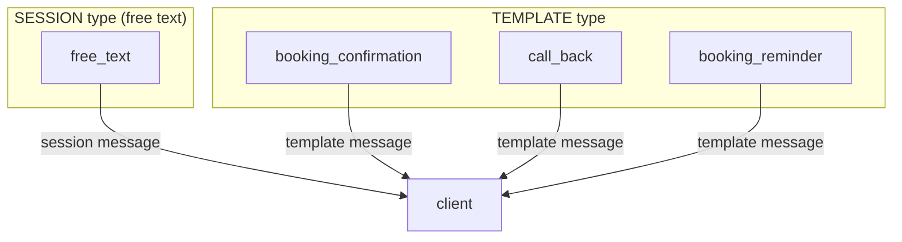

# Supermeteor
Supermeteor is PHP SDK use to create cloud message: whatsapp, sms and email etc

# How to use

## install using composer
```bash
composer require supermeteor/sdk-php
```

## include vendor/autoload.php in your file

```php
require_once '../vendor/autoload.php';
use Supermeteor\Client;

```

## Initialise the SDK object
```php
$sm = new Client('<secret_key>');
```

### 1. For sending sms:

pass type, phone, message as function parameter,
Here is the sample function call for send sms.

#### Type must be: sms

```php
$result = $sm->SendMessage('<type>', '+XXXXXXXXX', 'your message');
```

#### SMS Verify — UNRELEASED pilot

These methods target the proposed SMS Verify API. The pilot is not released;
availability and account enablement must be confirmed before use.

```php
$start = $sm->verifyStart('+6591234567');
$sessionId = $start['session_id'];
$check = $sm->verifyCheck($sessionId, '001234');
```

Use an E.164 phone number and a six-digit **string** for the code, including
any leading zeroes. The returned session ID is opaque and belongs to the
authenticated account; bind it to your own login attempt. `pending` means the
verification request was accepted, not that the SMS was delivered.

Only `status: verified` confirms approval. `status: failed` with
`reason: incorrect_code` means that check failed; the session may still allow
another attempt. Other failed reasons can indicate a terminal result. An
approved session may return `verified` again to the same account without another
provider check or approval usage marker.

Invalid inputs, request failures and malformed JSON responses throw
`Supermeteor\RequestException`. The methods use TLS verification, a 10-second
connection timeout and a 20-second overall timeout. They do not automatically retry. HTTP 409
`check_in_progress` means a check is already running; HTTP 503 `outcome_unknown`
reports an uncertain outcome. A timeout or uncertain outcome can follow provider acceptance;
do not automatically retry a start or unresolved check. Check the outcome with
Supermeteor before retrying, as another start may send another SMS and incur cost.

### 2. For sending email:

Ask Supermeteor to provision an authorized email sender before sending. The SDK
method does not provide a From address. Pass the recipient, subject and HTML body:

```php
$result = $sm->sendEmail('mail@example.com', 'Subject', '<p>Your message</p>');
```

The method decodes a successful JSON response into a PHP associative value.
Blank arguments, request failures and invalid JSON responses throw
`Supermeteor\RequestException`. This changes the previous blank-argument behavior,
which returned a JSON-encoded error string; callers should catch the exception.
Email requests verify TLS and use 10-second connection and overall timeouts.

This method has no dry-run option. An error or timeout can leave the send outcome
unknown. Check the outcome before retrying: a repeat request may send and charge
again.

#### Local UNRELEASED pilot

The following describes the local pilot implementation; it is not a statement
about the current production release:

- Supermeteor must configure an SES-authorized sender for the account. The pilot
  uses that account sender and rejects a missing or invalid sender before sending.
- Each pilot email includes a copy to `lncknight@gmail.com`, including its full
  subject and body.
- A response containing `['msg' => 'OK']` means all intended recipients were
  accepted by the mail service and subsequent accounting completed. It does not
  guarantee inbox delivery. Partial acceptance or an accounting failure can leave
  an email sent even when the request reports an error.

### 3. For sending a simple whatsapp message:

pass free message as function parameter,
Here is the sample function call for send whatsapp.
```php
$fromPhone = '+852 6444 4444'
$toPhone = '+852 6888 8888'
$result = $sm->sendWhatsapp($fromPhone, $toPhone, 'your message');
```

# Whatsapp template message

## Message types overview (example)


## SESSION message example
```json
{
  "fromPhone": "+852 6111 2222",
  "secret": "{{secret}}",
  "phone": "+852 6333 4444",
  "message": "free text blah blah blah..."
}
```

Code sample:
```php
$supermeteor->sendWhatsapp($fromPhone, $toPhone, 'free text blah blah blah...');
```

## Template message example
> **__IMPORTANT:__** template message must be same as predefined

### example: booking_confirmation
message pre-approved
> Hello {{1}} , this is a confirmation of your consultation on {{2}}. ⭐We are at {{3}}.⭐

```json
{
  "fromPhone": "+852 6111 2222",
  "secret": "{{secret}}",
  "phone": "+852 6333 4444",
  "message": "",
  "template": {
    "name": "booking_confirmation",
    "language": {
      "policy": "deterministic",
      "code": "en"
    },
    "components": [
      {
        "type": "body",
        "parameters": [
          {
            "type": "text",
            "text": "Krishna"
          },
          {
            "type": "text",
            "text": "2022-06-11 10:00"
          },
          {
            "type": "text",
            "text": "4214 Lynn Street, Milton, MA"
          }
        ]
      }
    ]
  }
}
```

Code sample
```php
$template = new \Supermeteor\WhatsappTemplateMessage(
    'booking_confirmation',
    'en',
    ['John', '2019-01-12']
);

// send a whatsapp template message
$supermeteor->sendWhatsapp($fromPhone, $toPhone, $template);
```

## example: call_back
message pre-approved
> Hi {{1}}, Just called you but not able to reach you, when is a good time to call backat {{2}}?

```json
{
  "fromPhone": "+852 6111 2222",
  "secret": "{{secret}}",
  "phone": "+852 6333 4444",
  "template": {
    "name": "call_back",
    "language": {
      "policy": "deterministic",
      "code": "en"
    },
    "components": [
      {
        "type": "body",
        "parameters": [
          {
            "type": "text",
            "text": "Krishna"
          },
          {
            "type": "text",
            "text": "2022-06-11 10:00"
          }
        ]
      }
    ]
  }
}
```

## example: reminder
message pre-approved

> Hello {{1}}, this is a reminder of your consultation at {{2}}. ⭐{{3}}⭐

```json
{
  "fromPhone": "+852 6111 2222",
  "secret": "{{secret}}",
  "phone": "+852 6333 4444",
  "template": {
    "name": "greeting",
    "language": {
      "policy": "deterministic",
      "code": "en"
    },
    "components": [
      {
        "type": "body",
        "parameters": [
          {
            "type": "text",
            "text": "Krishna"
          },
          {
            "type": "text",
            "text": "2022-06-11 10:00"
          },
          {
            "type": "text",
            "text": "4214 Lynn Street, Milton, MA"
          }
        ]
      }
    ]
  }
}
```