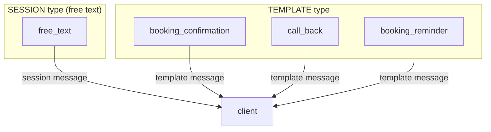

# Supermeteor PHP SDK

PHP SDK for sending SMS, WhatsApp, and email via Supermeteor.

## Installation

```bash
composer require supermeteor/sdk-php
```

## Quick Start

```php
require_once 'vendor/autoload.php';

use Supermeteor\Client;

$sm = new Client('<secret_key>');
```

## 1. Send SMS

```php
$result = $sm->SendMessage('sms', '+6591234567', 'Your message');
```

### SMS Verify (Unreleased Pilot)

Confirm pilot availability and account enablement with Supermeteor before use.

```php
$start = $sm->verifyStart('+6591234567'); // E.164 format
$sessionId = $start['session_id'];

$check = $sm->verifyCheck($sessionId, '001234'); // 6-digit string (preserve leading zeroes)
```

**Direct API (charges apply):**

```bash
curl -X POST 'https://api.supermeteor.com/sms/verifyStart' \
  -H 'Content-Type: application/json' \
  -d '{"secret":"<account_secret>","phone_number":"+6591234567"}'

curl -X POST 'https://api.supermeteor.com/sms/verifyCheck' \
  -H 'Content-Type: application/json' \
  -d '{"secret":"<account_secret>","session_id":"<opaque_session_id>","code":"001234"}'
```

**Behavior & Errors:**
- `session_id` is opaque, scoped to your account, and expires in 10 minutes (checks do not extend it).
- `status: pending` means accepted, not delivered; only `status: verified` confirms approval.
- `status: failed` with `reason: incorrect_code` may allow another attempt; other failure reasons can be terminal.
- Throws `Supermeteor\RequestException` on invalid input, HTTP/network failure, or malformed JSON (TLS verified; 10s connect / 20s total timeout; no auto-retry).
- HTTP `409 check_in_progress` means a check is already running; HTTP `503 outcome_unknown` or timeouts may follow provider acceptance—verify the outcome before retrying to avoid duplicate SMS charges.

## 2. Send Email

Requires an authorized sender provisioned by Supermeteor (the SDK does not accept a `From` address).

```php
$result = $sm->sendEmail('mail@example.com', 'Subject', '<p>Your message</p>');
```

**Direct API (charges apply):**

```bash
curl -X POST 'https://api.supermeteor.com/email/send' \
  -H 'Content-Type: application/json' \
  -d '{"secret":"<account_secret>","email":"mail@example.com","subject":"Subject","message":"<p>Your message</p>"}'
```

**Behavior & Errors:**
- Returns decoded JSON as an associative array.
- Throws `Supermeteor\RequestException` on blank arguments, request failures, or invalid JSON (TLS verified; 10s connect/total timeout; no dry-run).
- Timeouts or errors can leave the send outcome unknown—check before retrying to avoid duplicate sends and charges.

### Email (Unreleased Local Pilot)

- Uses the account's SES-authorized sender and rejects missing/invalid senders before sending.
- Copies `lncknight@gmail.com` on every pilot email (including full subject and body).
- `['msg' => 'OK']` confirms mail service acceptance and accounting, not inbox delivery.

### 3. For sending a simple whatsapp message:

pass free message as function parameter,
Here is the sample function call for send whatsapp.
```php
$fromPhone = '+852 6444 4444'
$toPhone = '+852 6888 8888'
$result = $sm->sendWhatsapp($fromPhone, $toPhone, 'your message');
```

# Whatsapp template message

## Message types overview (example)


## SESSION message example
```json
{
  "fromPhone": "+852 6111 2222",
  "secret": "{{secret}}",
  "phone": "+852 6333 4444",
  "message": "free text blah blah blah..."
}
```

Code sample:
```php
$supermeteor->sendWhatsapp($fromPhone, $toPhone, 'free text blah blah blah...');
```

## Template message example
> **__IMPORTANT:__** template message must be same as predefined

### example: booking_confirmation
message pre-approved
> Hello {{1}} , this is a confirmation of your consultation on {{2}}. ⭐We are at {{3}}.⭐

```json
{
  "fromPhone": "+852 6111 2222",
  "secret": "{{secret}}",
  "phone": "+852 6333 4444",
  "message": "",
  "template": {
    "name": "booking_confirmation",
    "language": {
      "policy": "deterministic",
      "code": "en"
    },
    "components": [
      {
        "type": "body",
        "parameters": [
          {
            "type": "text",
            "text": "Krishna"
          },
          {
            "type": "text",
            "text": "2022-06-11 10:00"
          },
          {
            "type": "text",
            "text": "4214 Lynn Street, Milton, MA"
          }
        ]
      }
    ]
  }
}
```

Code sample
```php
$template = new \Supermeteor\WhatsappTemplateMessage(
    'booking_confirmation',
    'en',
    ['John', '2019-01-12']
);

// send a whatsapp template message
$supermeteor->sendWhatsapp($fromPhone, $toPhone, $template);
```

## example: call_back
message pre-approved
> Hi {{1}}, Just called you but not able to reach you, when is a good time to call backat {{2}}?

```json
{
  "fromPhone": "+852 6111 2222",
  "secret": "{{secret}}",
  "phone": "+852 6333 4444",
  "template": {
    "name": "call_back",
    "language": {
      "policy": "deterministic",
      "code": "en"
    },
    "components": [
      {
        "type": "body",
        "parameters": [
          {
            "type": "text",
            "text": "Krishna"
          },
          {
            "type": "text",
            "text": "2022-06-11 10:00"
          }
        ]
      }
    ]
  }
}
```

## example: reminder
message pre-approved

> Hello {{1}}, this is a reminder of your consultation at {{2}}. ⭐{{3}}⭐

```json
{
  "fromPhone": "+852 6111 2222",
  "secret": "{{secret}}",
  "phone": "+852 6333 4444",
  "template": {
    "name": "greeting",
    "language": {
      "policy": "deterministic",
      "code": "en"
    },
    "components": [
      {
        "type": "body",
        "parameters": [
          {
            "type": "text",
            "text": "Krishna"
          },
          {
            "type": "text",
            "text": "2022-06-11 10:00"
          },
          {
            "type": "text",
            "text": "4214 Lynn Street, Milton, MA"
          }
        ]
      }
    ]
  }
}
```

## Publishing a release

The `Publish to Packagist` GitHub Actions workflow runs when a version tag such as
`v1.8.0` is pushed. It validates Composer metadata, runs the offline tests, and
requests a refresh of the existing `supermeteor/sdk-php` Packagist package.

One-time setup in **GitHub repository Settings → Secrets and variables → Actions**:

- **Variables tab** → **New repository variable**: `PACKAGIST_USERNAME`, the Packagist username of a package maintainer.
- **Secrets tab** → **New repository secret**: `PACKAGIST_API_TOKEN`, that maintainer's Packagist API token. Prefer a dedicated
  update token where available.

Merge the workflow and SDK changes before tagging the intended release commit:

```bash
git tag -a v1.8.0 -m "Add email and SMS verification APIs"
git push origin v1.8.0
```

Use a new version for each release; Composer derives it from the Git tag.
Check the Actions run and https://packagist.org/packages/supermeteor/sdk-php for
the new version. If a refresh fails after validation, fix the configuration and
rerun the failed job. A failed workflow does not remove the Git tag or prevent
Packagist's existing auto-update integration from discovering it independently.
